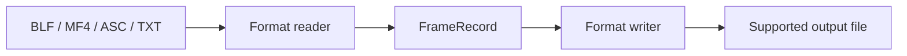

<div align="center">

# CAN Message Converter

**Convert CAN logs, keep the workflow local.**


[](LICENSE)

<p align="center">
  <a href="#features">Key Features</a> •
  <a href="#quick-start">Quick Start</a> •
  <a href="#workflow">Workflow</a> •
  <a href="#structure">Project Structure</a> •
  <a href="#documentation">Documentation</a>
</p>

[English](README.md) · [简体中文](README_zh.md)

[Repository](https://github.com/langesmesser/can-message-converter) · [Issues](https://github.com/langesmesser/can-message-converter/issues)

</div>

---

<a name="overview"></a>

## Overview

A Python and PySide6 desktop CAN log converter with a shared FrameRecord representation, batch processing, progress updates and selectable themes.

---

<a name="features"></a>

## Key Features

<table>
  <tr>
    <td width="50%" valign="top">
      <h3>Shared representation</h3>
      <p>Connect format readers and writers through FrameRecord rather than pairwise adapters.</p>
    </td>
    <td width="50%" valign="top">
      <h3>Explicit conversion paths</h3>
      <p>Read BLF, MF4, ASC and TXT; supported output combinations are listed in the format matrix.</p>
    </td>
  </tr>
  <tr>
    <td width="50%" valign="top">
      <h3>Batch progress</h3>
      <p>Run conversions through QThread and a thread pool with per-file Qt progress signals.</p>
    </td>
    <td width="50%" valign="top">
      <h3>Local desktop workflow</h3>
      <p>Use eight theme families with light and dark modes and export TXT logs to XLSX.</p>
    </td>
  </tr>
</table>

---

<a name="workflow"></a>

## Workflow



---

<a name="quick-start"></a>

## Quick Start

Use a Python environment compatible with PySide6, python-can and asammdf. Install dependencies before launching the GUI:

```bash
git clone https://github.com/langesmesser/can-message-converter.git
cd can-message-converter
python -m venv .venv
# Windows: .venv\Scripts\activate
# macOS / Linux: source .venv/bin/activate
python -m pip install -r requirements.txt
python src/main.py
```

Drop input files into the window, choose a supported output format and convert. Output is written beside the input files. TXT input also supports XLSX export.

### Supported conversion paths

| Input | Output |
| --- | --- |
| BLF | MF4 / ASC / CSV |
| MF4 | BLF / ASC / CSV |
| ASC | BLF / MF4 / CSV |
| TXT | ASC / XLSX |

---

<a name="structure"></a>

## Project Structure

```text
can-message-converter/
├── src/main.py             # GUI entry point
├── src/converters/         # Format readers, writers and registry
├── src/worker.py           # Batch tasks and progress signals
├── src/ui/                 # Desktop interface and themes
├── tests/                  # Automated validation
└── build.spec              # PyInstaller build configuration
```

---

<a name="development"></a>

## Development and Validation

```bash
python -m pytest tests/ -v
pyinstaller build.spec --noconfirm
```

Tests cover converters, the format registry, integration paths and UI themes. Use the current local test output as the result.

---

<a name="documentation"></a>

## Documentation

- [Formats and usage](#quick-start)
- [Development and Validation](#development)

---

<a name="contributing"></a>

## Contributing

When reporting an issue, include the OS, version, reproduction steps, expected behavior and redacted logs. Check the relevant guidance and implementation, and run validation appropriate to your change.

---

<a name="license"></a>

## License and Attribution

See [MIT](LICENSE) for the license.

<div align="center">

### Project Activity

[](https://www.star-history.com/#langesmesser/can-message-converter&Date)

[Contributors](https://github.com/langesmesser/can-message-converter/graphs/contributors)

</div>
