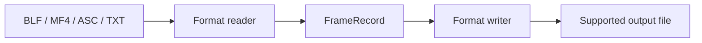

<div align="center">

# CAN Message Converter

**Convert CAN logs, keep the workflow local.**  
*转换 CAN 日志，让流程留在本地。*


[](LICENSE)

<p align="center">
  <a href="#features">核心特性</a> •
  <a href="#quick-start">快速上手</a> •
  <a href="#workflow">工作流程</a> •
  <a href="#structure">项目结构</a> •
  <a href="#documentation">文档导航</a>
</p>

[English](README.md) · [简体中文](README_zh.md)

[仓库主页](https://github.com/langesmesser/can-message-converter) · [反馈问题](https://github.com/langesmesser/can-message-converter/issues)

</div>

---

<a name="overview"></a>

## 项目简介

基于 Python 与 PySide6 的桌面 CAN 日志转换工具，通过统一 FrameRecord 中间表示读取与写出数据，提供批量处理、实时进度与主题切换。

---

<a name="features"></a>

## 核心特性

<table>
  <tr>
    <td width="50%" valign="top">
      <h3>统一数据表示</h3>
      <p>读写模块通过 FrameRecord 连接，减少格式间点对点耦合。</p>
    </td>
    <td width="50%" valign="top">
      <h3>明确转换路径</h3>
      <p>支持 BLF、MF4、ASC、TXT 输入；输出组合以格式矩阵为准。</p>
    </td>
  </tr>
  <tr>
    <td width="50%" valign="top">
      <h3>批量进度</h3>
      <p>QThread 与线程池执行转换，Qt 信号更新每个文件的处理进度。</p>
    </td>
    <td width="50%" valign="top">
      <h3>本地桌面体验</h3>
      <p>提供 8 组主题与明暗模式；TXT 可导出 XLSX。</p>
    </td>
  </tr>
</table>

---

<a name="workflow"></a>

## 工作流程



---

<a name="quick-start"></a>

## 快速上手

需要可运行 PySide6、python-can 与 asammdf 的 Python 环境。先安装依赖，再启动界面：

```bash
git clone https://github.com/langesmesser/can-message-converter.git
cd can-message-converter
python -m venv .venv
# Windows: .venv\Scripts\activate
# macOS / Linux: source .venv/bin/activate
python -m pip install -r requirements.txt
python src/main.py
```

拖入输入文件，选择目标格式，点击转换；输出默认写入输入文件所在目录。TXT 输入可使用 XLSX 导出按钮。

### 支持的转换路径

| 输入 | 输出 |
| --- | --- |
| BLF | MF4 / ASC / CSV |
| MF4 | BLF / ASC / CSV |
| ASC | BLF / MF4 / CSV |
| TXT | ASC / XLSX |

---

<a name="structure"></a>

## 项目结构

```text
can-message-converter/
├── src/main.py             # GUI 启动入口
├── src/converters/         # 格式读写与注册表
├── src/worker.py           # 批量任务与进度信号
├── src/ui/                 # 桌面界面与主题
├── tests/                  # 转换与界面测试
└── build.spec              # PyInstaller 打包配置
```

---

<a name="development"></a>

## 开发与验证

```bash
python -m pytest tests/ -v
pyinstaller build.spec --noconfirm
```

测试覆盖转换器、格式注册表、集成路径与界面主题。实际测试结果以本地运行输出为准。

---

<a name="documentation"></a>

## 文档导航

- [格式矩阵与操作](#quick-start)
- [开发与验证](#development)

---

<a name="contributing"></a>

## 参与贡献

反馈时请说明系统、版本、使用步骤、预期行为和脱敏日志。提交改动前核对相关指南与实际实现，并运行与改动有关的验证。

---

<a name="license"></a>

## 许可证与来源

许可证见 [MIT](LICENSE)。

<div align="center">

### 项目活动

[](https://www.star-history.com/#langesmesser/can-message-converter&Date)

[贡献记录](https://github.com/langesmesser/can-message-converter/graphs/contributors)

</div>
